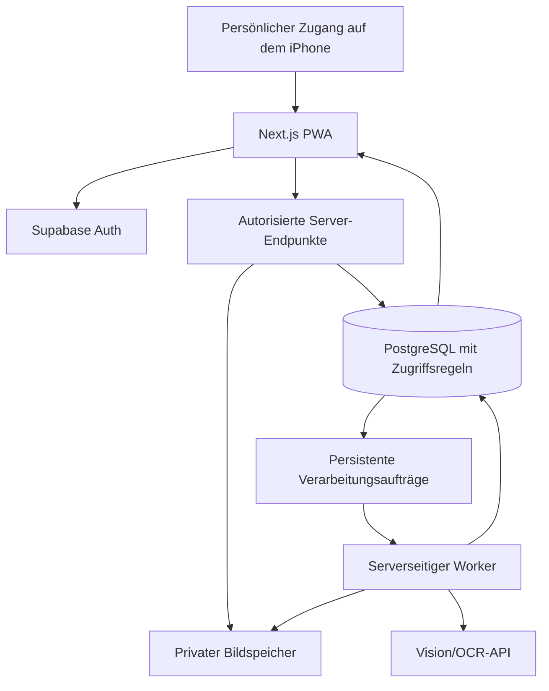

# Architektur und Infrastruktur

[Zur Übersicht](../README.md)

## Entscheidung: installierbare Web-App

Die erste Version wird eine responsive Progressive Web App (PWA). Alle verwenden denselben Link und können die App auf dem iPhone über Safari zum Home-Bildschirm hinzufügen. Das ermöglicht eine gemeinsame Version ohne App-Store-Veröffentlichung.

Der unterstützte Screenshot-Weg ist zunächst die Bildauswahl innerhalb der App. Ein eigener Eintrag als Empfänger im iOS-Teilen-Menü wird für die PWA nicht versprochen; dafür wäre später eine native Erweiterung zu prüfen. Offline kann die Oberfläche einen Hinweis anzeigen. Upload, Verarbeitung und Buchung benötigen in der ersten Version eine Internetverbindung.

## Komponenten

| Komponente | Aufgabe | Grenze |
| --- | --- | --- |
| Next.js und TypeScript | Mobile Ansichten, Upload, Erkennungsvorschau, Statistik | Keine geheimen Anbieter-Schlüssel im Browser |
| Vercel | Web-App und kurze API-Aufrufe | Kein minutenlang offener Upload-Request während OCR |
| Supabase Auth | Anmeldung per E-Mail-Code, Sitzungen, Einladungszuordnung | Jede Person verwendet einen eigenen Zugang |
| PostgreSQL | Verlässliche Zustände, Rollen, Buchungen und Statistiken | Berechtigungen werden serverseitig und per RLS geprüft |
| Privater Storage-Bucket | Originalbilder und kurzlebige Zugriffslinks | Keine öffentlichen Screenshot-URLs |
| `processing_jobs` und Worker | OCR ausführen, Fehler wiederholen, Ergebnisse speichern | Wiederholte Verarbeitung darf nicht erneut abbuchen |
| Vision/OCR-Anbieter | Sichtbare Felder strukturiert auslesen | Darf keine Buchungen, Personenwahl oder Datenbankaktionen auslösen |

Für den Start genügt eine Datenbank-Auftragsliste mit einem Supabase-Edge-Function-Worker. Ein Upload kann den Worker anstossen; ein geplanter Aufruf übernimmt liegen gebliebene Aufträge. Der Worker reserviert einen Auftrag atomar mit Ablaufzeit. Bei einem Timeout kann er später erneut übernommen werden. Ein eigener Redis- oder Kubernetes-Betrieb ist dafür nicht nötig.

## Ablauf und Konsistenz

1. Der Server prüft Sitzung, aktive Gruppenmitgliedschaft und Dateigrenzen.
2. Er erstellt einen Upload-Datensatz und erlaubt das Schreiben an genau dessen privaten Speicherpfad.
3. Nach erfolgreichem Upload werden Dateityp, Bildabmessungen und Prüfsumme validiert. Ein persistenter Auftrag wird angelegt.
4. Der Worker lädt das Bild, ruft die Erkennung auf und validiert das Ergebnis gegen ein festes Schema und fachliche Regeln.
5. Die App zeigt die erkannten Werte und eventuelle Prüfhinweise.
6. Ein bestätigter Auftrag bucht Fahrt, persönliches Minutenjournal und Paketverbrauch in **einer Datenbanktransaktion**.
7. Statistiken verwenden ausschliesslich verbuchte, nicht stornierte Fahrten und deren wirksame Buchungen.

Wiederholte Bestätigungen verwenden denselben Idempotenzschlüssel. Ein eindeutiger Datenbankschlüssel verhindert eine zweite Buchung derselben Fahrtversion. Gleichzeitige Uploads reservieren Paketbestände transaktional, damit dieselben Minuten nicht mehrfach zugeteilt werden. Ist die Paketzuordnung noch unbekannt, bleibt die Kostenbewertung offen; der bestätigte Verbrauch wird dennoch erfasst.

Die Oberfläche kann den Bearbeitungsstatus zunächst periodisch abrufen. Realtime-Abonnements sind eine spätere Optimierung.

## Berechtigungen

- **Mitglied:** eigene Screenshots hochladen, eigene Entwürfe prüfen, Gruppenstatistik und Buchungshistorie sehen, Korrekturen eigener verbuchter Fahrten anfragen.
- **Admin:** zusätzlich Mitglieder einladen/deaktivieren, Pakete erfassen, Guthaben zuweisen, Korrekturen und Bestandsabgleiche buchen.
- Originalbilder sehen standardmässig nur die hochladende Person und Gruppenadmins. Andere Mitglieder benötigen für Statistiken keine Bilder.
- Alle Gruppendaten tragen eine `group_id`. Fremde Gruppen- oder Nutzer-IDs in Requests verleihen keine Rechte.
- RLS schützt Datenbank und Storage; Rollenänderungen, Journalbuchungen und Bestandskorrekturen sind serverseitige Operationen.
- Ein privilegierter Worker-Schlüssel bleibt im Secret-Store. Endpunkte mit diesem Schlüssel prüfen die Berechtigung ausdrücklich, da privilegierte Schlüssel RLS umgehen können.

## Daten und Betrieb

- Datenbank und Bildspeicher in einer verfügbaren EU-Region anlegen. Das legt die Verarbeitungsregion des OCR-Anbieters nicht automatisch fest; diese wird separat geprüft und in der App transparent gemacht.
- Nur das für die Erkennung benötigte Bild an den OCR-Dienst senden. Namen und Gruppenmitglieder muss dieser nicht kennen.
- Vorgeschlagene Bildaufbewahrung: 30 Tage nach endgültiger Bearbeitung, anschliessend automatische Löschung. Offene Prüfungen erhalten eine eigene begrenzte Frist mit Hinweis vor dem Löschen. Buchungsdaten bleiben erhalten.
- Kein Volltext aus Fahrtbildern, keine Bilder und keine Secrets in Anwendungslogs. Für Fehlerdiagnosen genügen interne Auftrags-ID, Fehlerklasse, Laufzeit und Versuchszahl.
- Upload-Grösse, Dateityp, Anzahl paralleler Aufträge und OCR-Ausgaben begrenzen. Die Upload-Grenze ist konfigurierbar; als Startwert eignen sich 10 MB für PNG/JPEG.
- Authentifizierte Antworten und Screenshots werden nicht im öffentlichen PWA-Cache abgelegt. Beim Abmelden lokale persönliche Zustände entfernen.
- Datenbankbackups und Wiederherstellung vor produktiver Nutzung einrichten und prüfen. Storage-Objekte sind separat zu behandeln; ein Datenbankbackup enthält nicht automatisch die Bilddateien.
- Entwicklung und Produktion erhalten getrennte Supabase-Projekte und Secrets. Vorschau-Deployments greifen nicht auf echte Fahrtdaten zu.

## Deployment-Reihenfolge

1. Next.js-Projekt, PWA-Manifest und mobile Navigation erstellen.
2. Supabase-Projekt, SQL-Migrationen, RLS und privaten Bucket einrichten.
3. Login und Einladungen mit korrekten Redirect-URLs verbinden; E-Mail-Zustellung für echten Betrieb konfigurieren.
4. Server-Endpunkte, Auftragsverarbeitung und OCR integrieren.
5. Secrets in den jeweiligen Hosting-Diensten hinterlegen; nur öffentliche Auth-Konfiguration darf ins Browser-Bundle.
6. Testumgebung mit synthetischen Daten bereitstellen und die Abnahmekriterien aus der [Roadmap](roadmap.md) erfüllen.
7. Produktionsumgebung mit eigenem Datenbestand veröffentlichen, Backup und Ausgabenlimits kontrollieren.

## Laufende Kosten

Die Kosten bestehen aus Web-Hosting, Supabase, OCR pro Bild sowie gegebenenfalls Domain und E-Mail-Versand. Für drei Personen ist ein kleiner Betrieb zu erwarten; ob kostenlose Tarife genügen, hängt von aktuellen Anbieterbedingungen, Speicher, Backups und OCR-Nutzung ab.

Vor dem Deployment die aktuellen Tarife prüfen und ein monatliches Ausgabenlimit beziehungsweise Warnungen einrichten. Es wird hier kein ungeprüfter Fixpreis zugesagt. Das Erstellen dieses Repositories legt keine kostenpflichtigen Cloud-Ressourcen an.
