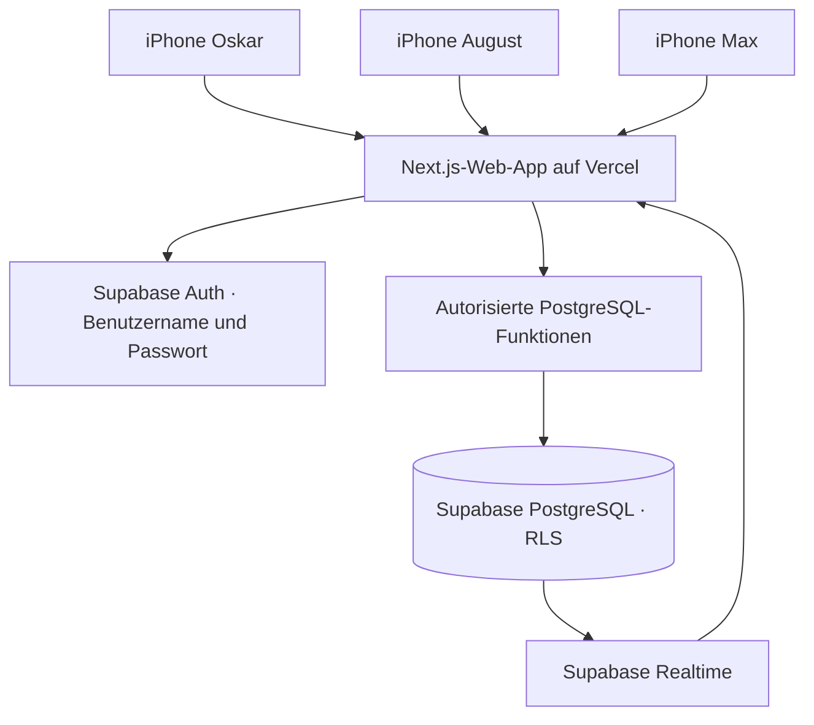

# Architektur und Synchronisierung

[Zur Übersicht](../README.md) · [Einrichtung](setup.md)

## Implementierte Version

Im eingerichteten Betrieb liefert Vercel die responsive Next.js-App aus. Jede Person nutzt einen eigenen Supabase-Auth-Zugang. Alle Geräte einer Gruppe lesen und schreiben denselben PostgreSQL-Datenbestand. Der Browser verwendet ausschliesslich den öffentlichen Supabase-Key und die Sitzung der angemeldeten Person; die Supabase Edge Functions verwenden für die Kontoverwaltung einen serverseitigen Service-Role-Key.

## Ein gemeinsamer Stand

`get_dashboard` liest Mitglieder, Fahrten, Journal und Pakete in einer gemeinsamen PostgreSQL-Abfrage. Dadurch entsteht keine Kombination aus neuer Fahrt und altem Guthaben durch mehrere voneinander unabhängige HTTP-Abfragen. Der Browser berechnet die Anzeige aus diesem gemeinsamen Ergebnis.

Supabase Realtime dient als Änderungshinweis. Nach einer Änderung wird der vollständige aktuelle Gruppenstand erneut geladen. Zusätzlich geschieht das:

- nach erfolgreicher eigener Buchung;
- nach erfolgreichem Aufbau einer Realtime-Verbindung;
- bei Rückkehr in die sichtbare App und Fensterfokus;
- wenn eine Internetverbindung wieder verfügbar ist;
- alle 30 Sekunden, solange die App sichtbar ist;
- beim manuellen Neuladen über das Symbol in der Kopfzeile.

Mehrere fast gleichzeitig eintreffende Hinweise werden kurz gebündelt. Eine ältere HTTP-Antwort überschreibt keine neuere Anfrage. Ein Gruppenwechsel beendet das vorherige Abonnement. Fehler lassen den letzten gelesenen Stand mit einer sichtbaren Fehlermeldung stehen. Die Anzeige «Live verbunden» bezeichnet den Kanalzustand und ist keine Garantie gegen jede Netzstörung.

Im Offline-Zustand werden keine Buchungen angenommen. iOS kann geschlossene oder im Hintergrund liegende Web-Apps anhalten; sie laden beim erneuten Öffnen nach. Es gibt keinen Service Worker und keine Offline-Warteschlange. Nur die ausdrücklich ausgewählte Demo persistiert Beispieldaten im lokalen Browser-Speicher.

## Sichere Buchungen

Alle kritischen Mutationen sind Datenbankfunktionen mit eigener Berechtigungsprüfung. Ein kurzes Gruppenschloss serialisiert gleichzeitige Buchungen. Die gemeinsame Aufladung speichert Paket, Beitragsliste und sämtliche Minutengutschriften atomar. Fahrt und Verbrauchseintrag werden gemeinsam oder gar nicht gespeichert. Salden werden aus einem Journal abgeleitet; es gibt keinen überschreibbaren Kontostand.

Jeder Buchungsversuch erhält einen UUID-Idempotenzschlüssel. Das interne Schema `app_private.commands` speichert Aktion und Nutzdaten. Ein identischer Retry hat keine zweite Wirkung; derselbe Schlüssel mit anderen Daten wird abgewiesen. Im Browser bleibt der Schlüssel innerhalb eines geöffneten Eingabevorgangs auch nach einem Fehler erhalten. War der erste Versuch bereits verbucht, werden geänderte Nutzdaten zurückgewiesen statt als zweite Aufladung gespeichert. Eine bewusst neu geöffnete Eingabe erhält einen neuen Schlüssel. Nach einem vollständigen Neuladen ist dieser Schlüssel nicht dauerhaft gespeichert: Bei unklarem Ausgang zuerst die Fahrtenliste prüfen. Die App erkennt in dieser Version keine inhaltlich doppelt manuell eingegebenen Fahrten.

Eine Stornierung durch einen Admin markiert die ursprüngliche Fahrt und erzeugt eine Gegenbuchung. Rollenänderungen dürfen den letzten aktiven Admin nicht entfernen. Deaktivierte Mitglieder verlieren Datenzugriff und Schreibrechte; ihre Historie bleibt erhalten.

## Berechtigungen

RLS erlaubt ausschliesslich aktiven Gruppenmitgliedern das Lesen der jeweiligen Gruppendaten. Einladungen sind nur für Admins lesbar. Direkte Tabellenänderungen durch den Browser sind nicht erlaubt. Private Hilfsfunktionen sind für Mitglieder nicht aufrufbar; allein der RLS-Prüfhelfer ist entsprechend freigegeben.

Die RPCs legen die fahrende Person aus `auth.uid()` fest. Der Browser kann keine andere Person als Fahrer einschleusen. Paketkäufer und Guthabenempfänger werden auf Zugehörigkeit zur selben Gruppe geprüft. Einladungscodes enthalten 128 Bit Zufall, sind für sieben Tage gültig und verleihen nach Anmeldung ausschliesslich die Rolle Mitglied. Sie liegen im geschützten Datenbestand und werden nur privat geteilt.

## Spätere API-Erkennung

`lib/recognition.ts` beschreibt eine austauschbare OCR-Schnittstelle. Noch gibt es weder Upload-Endpunkt noch Bildspeicher, Worker oder Anbieteraufrufe. DeepSeek Flash beziehungsweise die OCR-API sind als Kandidaten vorgemerkt; Genauigkeit und aktueller Preis werden vor Integration erneut geprüft.

Die spätere Verarbeitung muss serverseitig erfolgen. Das Modell liest ausschliesslich sichtbare Felder. Der Server addiert Fahr- und Pausierzeit, prüft Duplikate und legt die Person über den Login fest. Anbieter-Schlüssel bleiben ausserhalb des Browser-Bundles. Details: [Screenshot-Erkennung](screenshot-recognition.md).

## Betrieb

[Die Einrichtungsanleitung](setup.md) beschreibt Supabase-Projekt, SQL-Migration, Konto-Funktionen, Anmeldung und Vercel-Variablen. Es gibt keine bereits provisionierten Cloud-Ressourcen in diesem Repository. Die lokale Testumgebung verwendet eine echte PostgreSQL-Engine via PGlite, jedoch keine echte Supabase-Auth- oder Realtime-Infrastruktur.

Das Dashboard lädt zunächst alle Gruppendatensätze in einem JSON-Ergebnis. Es gibt deshalb keine stille REST-Standardbegrenzung auf 1'000 Zeilen. Für grosse Gruppen oder umfangreiche Historien sind später serverseitige Aggregationen und Seitennavigation vorzusehen.
