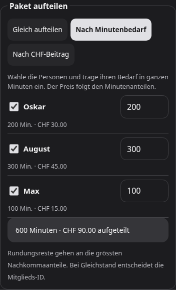

# Minutenclub benutzen

Minutenclub führt Buch über die Dott-Minuten, die eure Gruppe gemeinsam kauft. Jede Person meldet sich mit Benutzername und Passwort an. Eure Einträge bilden die Grundlage für die angezeigten Salden. Der Minutenclub kauft selbst keine Pakete bei Dott.

## Zum ersten Mal öffnen

**Ausprobieren.** Öffne im Browser die App und wähle die Demo. Du siehst Beispieldaten für Oskar, August und Max und kannst alle Admin-Abläufe ausprobieren. Die Demo speichert Änderungen auf diesem Gerät in diesem Browser. «Zurücksetzen» am Seitenende lädt wieder die Ausgangsdaten. Für einen lokalen Start auf dem Laptop gibt es unten eine Anleitung.

**Eurer Gruppe beitreten.** Öffne den Einladungslink vom Admin. Wenn du neu bist, erstelle ein Konto mit einem freien Benutzernamen und Passwort. Ein bereits vorhandenes Konto kann sich direkt anmelden. Beim Gruppenbeitritt gibst du deinen Anzeigenamen an. Der Link füllt den Einladungscode vor, alternativ kannst du ihn selbst eingeben. Neue Mitglieder starten mit null Minuten. Gib Einladungslink und Startpasswort nur privat weiter.

**Deine Einführung.** Beim ersten Besuch führt dich die Tour durch die Funktionen deiner Rolle. «Weiter» merkt sich die aktuelle Karte, «Überspringen» die ganze angebotene Tour. Schliesst du sie mit dem Kreuz, setzt du sie beim nächsten Besuch dort fort. Dein Konto übernimmt den Fortschritt auch auf einem anderen Gerät. Spätere Neuerungen erscheinen als «Neu für dich». Unter **Mitglieder → Einführung** kannst du jederzeit alle Karten nochmals öffnen.

**Passwort vergessen.** Wähle auf der Anmeldeseite «Passwort vergessen?», gib deinen Benutzernamen ein und sende die Anfrage. Ein Admin bearbeitet sie im Passwort-Dashboard unter **Mitglieder** und teilt dir das neue Passwort privat mit. Dein Anzeigename in der Gruppe und dein Benutzername für die Anmeldung haben unterschiedliche Aufgaben.

**Eine Gruppe gründen.** In einem frischen Projekt registriert sich die erste Person und wählt «Gruppe erstellen». Sie wird Admin und kann unter **Mitglieder → Einladung erstellen** einen sieben Tage gültigen Code für die Crew erzeugen. Unter «Links sperren» kann sie bestehende Einladungen widerrufen. Weitere Personen können jederzeit hinzukommen. Damit alle iPhones gemeinsame Daten sehen, muss eine Person zuvor Supabase und Vercel einrichten. [Einrichtung und Abnahme](setup.md)

## Eine Fahrt eintragen und kontrollieren

1. Öffne nach der Fahrt in Dott **Deine Fahrt → Details anzeigen**. Lies Fahrzeit und Pausierzeit ab. Das Feld «Gesamt» zeigt einen Geldbetrag.
2. Tippe im Minutenclub auf **Fahrt eintragen**. Das Formular zeigt deinen Namen. Gib beide Zeiten in ganzen Minuten ein. Ohne Pause lässt du die Pause bei null.
3. Prüfe die Summe und den Fahrtzeitpunkt. Bei einer nachgetragenen Fahrt kannst du den Zeitpunkt ändern. Die Eingabe verwendet die Zeitzone des Geräts, die Liste zeigt Zürich-Zeit.
4. Tippe auf **Speichern**. Bei 14 Minuten Fahrzeit und einer Minute Pause sinkt dein Guthaben um 15 Minuten. Aus 200 Minuten werden 185. Die Freischaltgebühr spielt für die Buchung keine Rolle.
5. Prüfe die Fahrt unter **Fahrten**. Falls nach einem Verbindungsabbruch unklar ist, ob sie gespeichert wurde, lade die Ansicht neu und suche den Eintrag, bevor du ein weiteres Formular öffnest.

**Fahrt vormerken.** Mit «Dott entsperren» merkst du dir die Startzeit. «Fahrt beenden» führt zur Erfassung. Prüfe die vorgeschlagenen Zeiten anhand der Dott-Fahrtdetails. Start und Ziel sind freiwillig. Die App fragt einen Gerätestandort nur auf deinen Knopfdruck ab. Erfasste Orte können für die Gruppe in den Orts- und Zeitstatistiken sichtbar sein. Die eigentliche Scooter-Freischaltung erfolgt in Dott.

Screenshots dienen momentan zum Ablesen. Die aktuelle Version erfasst die Werte manuell. [Geplante Screenshot-Erkennung](screenshot-recognition.md)

## Ein Paket kaufen und verteilen

Erfasse den Kauf einmal als Admin unter **Guthaben → Guthaben aufladen**. Wähle die Person, die das Paket gekauft hat, und trage Paketminuten, Paketpreis in CHF und Kaufzeitpunkt ein. Die kaufende Person darf auch für andere einkaufen. Die Aufteilung bestimmt, auf welchen Konten die Minuten landen.

| Schaltfläche       | Was du einträgst                                                                                                                   | Beispiel für 600 Minuten zu CHF 90                                                                            |
| ------------------ | ---------------------------------------------------------------------------------------------------------------------------------- | ------------------------------------------------------------------------------------------------------------- |
| Fair aufteilen     | Wähle die Teilnehmenden mit den Häkchen aus. Anfangs sind alle aktiven Mitglieder ausgewählt (je `1/N` vom Preis und den Minuten). | Oskar und Max machen mit (`1/2`). Beide erhalten 300 Minuten für je CHF 45. Augusts Konto bleibt unverändert. |
| Nach Minutenbedarf | Wähle die Personen und trage die gewünschten ganzen Minuten ein. Zusammen müssen sie die Paketgrösse ergeben.                      | Oskar braucht 200, August 300, Max 100 Minuten. Ihre Kostenanteile betragen CHF 30, CHF 45 und CHF 15.        |
| Nach CHF-Beitrag   | Trage pro Person den bereits bezahlten Betrag ein. Ein leeres Feld zählt als null. Die Summe muss dem Paketpreis entsprechen.      | Oskar zahlt CHF 60 und Max CHF 30. Sie erhalten 400 und 200 Minuten.                                          |



**Vor dem Speichern** siehst du Minuten und Kostenanteil pro Person. Bei 100 Minuten zu CHF 10 für drei Personen ergeben sich 34/33/33 Minuten und 334/333/333 Rappen. Ganze Minuten und Rappen werden jeweils separat gerundet. Restbeträge gehen an die grössten Nachkommaanteile, bei Gleichstand in der Reihenfolge der festen Mitglieds-IDs. Ein späterer Namenswechsel beeinflusst diese Reihenfolge nicht.

**Nach dem Speichern** findest du den Kauf unter **Guthaben → Minutenpakete** und die Gutschriften in der Buchungshistorie. Damit ist die Zuteilung abgeschlossen. Geldzahlungen erledigt ihr untereinander. **Minuten manuell geben** ist eine separate Admin-Buchung für eine kostenlose interne Gutschrift. Sie erhöht das persönliche Guthaben, während der erfasste Paketbestand gleich bleibt. Prüfe Preis und Mengen vor dem Buchen. Für fehlerhafte Paketkäufe und manuelle Gutschriften gibt es derzeit keine Korrektur in der App.

## Die Übersicht lesen

| Anzeige                | Bedeutung                                                                                                                                                                      |
| ---------------------- | ------------------------------------------------------------------------------------------------------------------------------------------------------------------------------ |
| Dein Restguthaben      | Erste grosse Zahl. Summe deiner Gutschriften, Fahrtabzüge und gegebenenfalls Storno-Gegenbuchungen.                                                                            |
| Von dir verbraucht     | Fahrzeit plus Pausen deiner gültigen Fahrten.                                                                                                                                  |
| Gemeinsamer Bestand    | Sämtliche erfassten Paketminuten abzüglich der gültigen Fahrten aller Mitglieder.                                                                                              |
| Kontingent & Verbrauch | Der breite transparente Balken zeigt alle zugeteilten Minuten einer Person. Der schmale gefüllte Balken zeigt ihren Verbrauch. Bei Überzug ragt er über das Kontingent hinaus. |
| Eure Crew              | Verbleibende Minuten für jedes Mitglied. Unter **Guthaben → Minutenkonten** findest du ebenfalls alle persönlichen Salden.                                                     |

Ein persönlicher Saldo darf negativ sein, damit ihr eine tatsächlich gefahrene Fahrt nachtragen könnt. Weicht der Gruppenbestand von der Summe der persönlichen Salden ab, prüft unter **Guthaben** die erfassten Pakete, die internen Gutschriften und «Noch nicht zugewiesen». Unter **Statistik** lassen sich Person und Zeitraum filtern. Die geschätzten Fahrtkosten stammen aus den beim Erfassen bekannten Paketpreisen. «Offen» bedeutet, dass eine Berechnungsgrundlage fehlt. [Abrechnungsregeln](data-model.md)

## Namen, Rechte und Stornos

- **Eigenen Namen ändern** geht unter **Mitglieder → Name ändern**. Fahrten und Guthaben bleiben derselben Person zugeordnet. Admins können auch die Namen anderer Mitglieder ändern.
- **Mitglieder verwalten** können Admins unter **Mitglieder**. Deaktivierte Personen verlieren den Zugriff. Ihre bisherigen Buchungen bleiben nachvollziehbar. Mindestens ein aktiver Admin muss erhalten bleiben.
- **Fahrt korrigieren.** Ein Admin sucht die Fahrt unter **Fahrten**, wählt **Stornieren** und gibt einen Grund an. Die Minuten werden einmal zurückgebucht. Danach erfasst die fahrende Person bei Bedarf die richtige Fahrt mit ihrem eigenen Login.
- **Storno ansehen.** Wähle unter **Fahrten** im Statusfilter **Storno-Verlauf**. Hier zählen Sortierung und Zeitraum ab dem Stornozeitpunkt. Die Zeile zeigt Grund, Zeitpunkt, ausführende Person soweit erfasst und die zurückgebuchten Minuten.

## Auf dem Laptop oder iPhone öffnen

Für die Demo brauchst du Git und Node.js, empfohlen ist Node.js 24 mit npm. Auf Windows kannst du in PowerShell frisch starten mit:

```powershell
git clone https://github.com/dnd67/dott-minuten.git
cd dott-minuten
npm.cmd ci
npm.cmd run dev
```

Hast du das Repository schon unter `C:\privatedev\dott-minuten`, wechsle mit `cd C:\privatedev\dott-minuten` dorthin und hole Änderungen mit `git pull --ff-only`. Unter macOS und Linux funktionieren dieselben npm-Befehle als `npm ci` und `npm run dev`.

Öffne [die lokale Demo](http://localhost:3000/?demo=1). Falls das Terminal einen anderen Port nennt, verwende diesen. Lass das Terminal geöffnet, solange du die App nutzt. Mit **Strg+C** beendest du den Server. Für die Handyansicht auf dem Laptop öffnest du in Chrome oder Edge die Entwicklertools mit **F12**, aktivierst mit **Strg+Umschalt+M** die Geräteansicht und wählst eine iPhone-Grösse.

Auf dem iPhone öffnest du die gemeinsame HTTPS-Adresse in Safari. Mit **Teilen → Zum Home-Bildschirm** erhältst du ein eigenes App-Symbol. Über die Designauswahl kannst du zwischen System, Hell und Dunkel wechseln. Bei aktivierter Systemeinstellung «Bewegung reduzieren» erscheinen Formulare und Navigation ohne die Übergangsanimationen.

## Wenn etwas fehlt

| Was du siehst                             | Was du tun kannst                                                                                                                                                |
| ----------------------------------------- | ---------------------------------------------------------------------------------------------------------------------------------------------------------------- |
| Verschiedene Salden auf zwei Geräten      | Prüfe Gruppenname und Login. Bei «Lokale Demo» hat jeder Browser eigene Beispieldaten. Im gemeinsamen Betrieb kannst du über das Aktualisieren-Symbol neu laden. |
| «Offline»                                 | Stelle die Verbindung wieder her und prüfe den letzten Eintrag. Zum Speichern in der gemeinsamen Gruppe ist Internet erforderlich.                               |
| Kein Knopf für «Guthaben aufladen»        | Öffne den Bereich **Guthaben** und prüfe deine Rolle unter **Mitglieder**. Ein Admin kann den Kauf erfassen.                                                     |
| Anmeldung oder Registrierung klappt nicht | Prüfe Benutzername, Passwort und bei einem neuen Konto den Einladungscode. Ist der Link abgelaufen oder gesperrt, kann ein Admin eine neue Einladung erstellen.  |
| `npm` wird in PowerShell nicht gefunden   | Installiere Node.js mit npm und öffne PowerShell neu. Prüfe `node --version` und `npm.cmd --version`.                                                            |

[Zur Projektübersicht](../README.md) · [Anleitung für Betreiber](setup.md)
