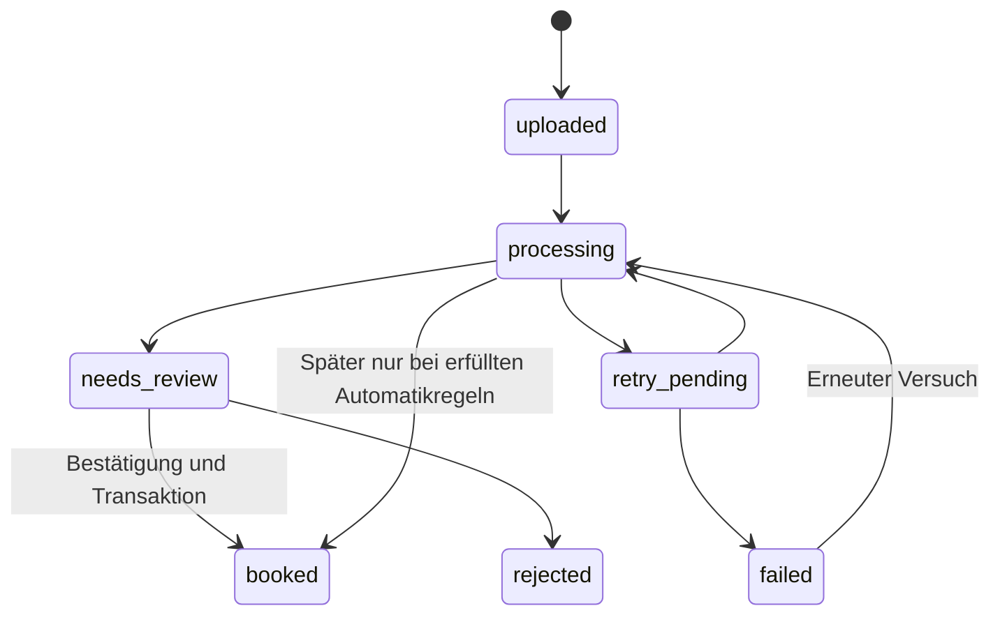

# Screenshot-Erkennung

[Zur Übersicht](../README.md)

**Vorgemerkte Erweiterung, in Version 1 nicht aktiviert.** Aktuell werden Fahr- und Pausenminuten manuell eingetragen. Die Schnittstelle steht in `lib/recognition.ts`; es gibt noch keinen Upload, Bildspeicher oder OCR-Aufruf. DeepSeek Flash beziehungsweise die DeepSeek-OCR-API sind Kandidaten für einen späteren Genauigkeitstest. Anbieter-Schlüssel werden erst dann serverseitig benötigt.

## Automatische Personenzuordnung

Jede Person lädt ihre eigene Fahrt hoch. Die App setzt deshalb die aktive Mitgliedschaft des angemeldeten Nutzers als fahrende Person. Der Nutzer kann die Zuordnung in der Vorschau sehen; eine fehlerhafte verbuchte Zuordnung wird über einen nachvollziehbaren Korrekturprozess geändert.

Ein Screenshot eines gemeinsam verwendeten Dott-Kontos kann die fahrende Person normalerweise nicht zuverlässig beweisen. Das Bildmodell soll deshalb keine Namen raten. Die serverseitige Personenzuordnung erfolgt unabhängig von der Bilderkennung.

## Zu erkennende Informationen

| Feld                                                       | Verwendung                                                                                      |
| ---------------------------------------------------------- | ----------------------------------------------------------------------------------------------- |
| Fahrzeit                                                   | Statistik und sichtbare Vorschau, intern in Sekunden                                            |
| Pausierzeit                                                | Separates Feld, zählt ebenfalls zum Minutenverbrauch                                            |
| Separat angezeigte Paketzeit                               | Falls vorhanden, Abgleich mit der berechneten Summe; bei Widerspruch Prüfung                    |
| Datum und Uhrzeit                                          | Fahrtenliste, Zeitraumfilter und Duplikatprüfung                                                |
| Fahrt-ID                                                   | Erkennen bereits erfasster Fahrten, sofern sichtbar                                             |
| Freischaltgebühr, Gesamtbetrag und durchgestrichene Preise | Für die interne Abrechnung ignorieren; CHF-Kosten aus Paketpreis und Minutenverbrauch berechnen |

Fehlende Felder werden als `null` ausgegeben. Dauer und belastete Zeit werden nicht miteinander vertauscht. Werte wie «12:30» müssen anhand der Beschriftung als Uhrzeit oder Dauer erkannt werden; das Format allein genügt nicht.

## Bekanntes Fahrtdetail-Layout und Gruppenregel

Die bereitgestellte Ansicht «Fahrtdetails» zeigt `Fahrzeit (14m)` und `Pausierzeit (1m)`. Nach ausdrücklicher Bestätigung durch den Nutzer zählen Pausen zum Paketverbrauch. Der Server berechnet daher **14 + 1 = 15 Minuten**. Die sichtbare Freischaltung von CHF 2.00 wird für die Gruppenabrechnung ignoriert; ebenso der Gesamtbetrag und die durchgestrichenen Tarifpreise. Diese Regel gilt für eure App und wird nicht als allgemeine Aussage über alle Dott-Tarife verstanden.

Die vorherige Ansicht «Deine Fahrt» ohne geöffnete Details enthält keine Dauer und reicht deshalb nicht für die Minutenbuchung. Die App fordert zum Hochladen der geöffneten Fahrtdetails auf. Die iPhone-Statusleistenzeit ist kein Fahrtzeitpunkt. Im bekannten Detailbild fehlen Fahrtdatum und Fahrt-ID; fehlende Datumsangaben müssen sichtbar ergänzt werden, statt sie aus der Statusleiste oder dem Uploadzeitpunkt abzuleiten.

Eine fehlende oder abgeschnittene Pausenzeile wird nicht automatisch zu null. Null ist nur bei explizitem Nullwert, manueller Bestätigung oder einem separat geprüften Layout ohne Pausenzeile zulässig. Widerspricht eine separat angezeigte Paketbelastung der Summe, geht der Vorgang zur Prüfung. Rundungen bei anderen Zeitformaten bleiben zu klären.

## Extraktionsvertrag

Der Worker erwartet strukturiertes JSON mit fester Schemaversion. Ein möglicher Vertrag ist:

```json
{
  "schema_version": 1,
  "document_type": "ride_receipt",
  "ride_reference": null,
  "ride_date_local": null,
  "ride_time_local": null,
  "duration_seconds": 840,
  "pause_seconds": 60,
  "displayed_charged_seconds": null,
  "evidence": {
    "duration": "Fahrzeit (14m)",
    "pause": "Pausierzeit (1m)"
  },
  "review_reasons": ["ride_datetime_missing"]
}
```

Das Textbeispiel beschreibt die relevanten Felder des bereitgestellten Layouts; das Originalbild wird nicht veröffentlicht. `charged_seconds` wird vom Server als 900 berechnet, nicht vom Modell geraten. Sichtbare Belegtexte werden auf die benötigten Felder begrenzt. Schema- und Werteprüfung erfolgen im Servercode; ein formal gültiges Modellresultat ist noch keine fachlich gültige Buchung.

Bildinhalte sind nicht vertrauenswürdige Eingaben. Darin enthaltene Anweisungen werden als Bildtext behandelt und können weder Tools aufrufen noch Identitäten, Buchungsregeln oder Berechtigungen verändern.

## Zustände und Fehlerbehandlung



Vorübergehende Anbieterfehler werden mit begrenzter Versuchszahl und zunehmender Wartezeit wiederholt. Dauerhafte Fehler erscheinen mit verständlichem Hinweis. Ein nicht lesbares Bild kann ersetzt oder durch einen als manuell erfasst gekennzeichneten Entwurf ergänzt werden. Ein OCR-Fehler allein verändert kein Guthaben.

## Einführung der Automatik

**Erste Version:** Die Zeit wird automatisch erkannt und vorausgefüllt. Die Person prüft die Vorschau und bestätigt mit einem Tippen. Fehlende Abrechnungsinformationen werden sichtbar ergänzt oder anhand einer bereits geprüften Gruppenregel bestimmt.

**Spätere automatische Buchung:** Aktivierbar für bereits getestete Screenshotvarianten, wenn alle notwendigen Felder vorhanden sind, Format und Werteprüfung bestehen, die Abrechnungsregel geklärt ist und kein Duplikatverdacht vorliegt. Jede automatische Buchung bleibt in der Historie erkennbar und korrigierbar.

Eine vom Bildmodell selbst genannte Prozentzahl genügt nicht als Freigabe. Die Regeln beruhen auf gemessenen Ergebnissen und überprüfbaren Feldern.

## Duplikate

1. Externe Fahrt-ID innerhalb der Gruppe vergleichen, falls vorhanden.
2. Dateiprüfsumme vergleichen, um ein identisches Bild zu erkennen.
3. Datum, Zeit, Dauer und Belastung auf verdächtige Übereinstimmung prüfen.
4. Bei zugeschnittenen oder anders komprimierten Bildern ohne eindeutige ID eine Prüfung verlangen, statt blind zu buchen oder eine andere Fahrt zu verwerfen.

Die Prüfung gilt gruppenweit, damit zwei Mitglieder dasselbe Bild nicht unabhängig belasten. Auftragswiederholungen und doppelte Klicks werden zusätzlich über Datenbank-Idempotenz abgesichert.

## Validierung vor Nutzung

Ein kleiner, bewusst variierter Satz anonymisierter Screenshots sollte unter anderem Folgendes abdecken:

- Unterschiedliche Layouts, Spracheinstellungen und Hell-/Dunkeldarstellung, soweit tatsächlich verwendet.
- Sekundenangaben, längere Fahrten und separat ausgewiesene Paketbelastung.
- Fahrzeit 14 Minuten plus Pause 1 Minute: genau 15 Minuten Verbrauch; Freischaltung und durchgestrichene Preise beeinflussen weder Minutenabzug noch interne Kosten.
- Fehlende Pausenzeile, explizit null Minuten Pause, unscharfe oder zugeschnittene Bilder.
- Übersicht ohne Details: keine Buchung; Handy-Uhrzeit niemals als Fahrtzeit übernehmen.
- Dasselbe Bild zweimal und dieselbe Fahrt in verschiedenen Bildausschnitten.
- Eine andere Bildschirmansicht, die gar keine abgeschlossene Fahrt zeigt.
- Unvollständige Datumsangaben und Uhrzeiten rund um einen Tageswechsel.

Für jedes Bild werden erwartete Felder manuell festgelegt. Gemessen werden korrekte Dauer, korrekte Belastung, angemessene Rückfragen und fälschlich freigegebene Buchungen. Automatik wird je unterstütztem Layout erst nach bestandener Prüfung aktiviert; unbekannte Varianten gehen zurück in die Vorschau.

Echte Fahrtbilder bleiben ausserhalb dieses öffentlichen Repositories. Öffentlich eincheckbar sind synthetische Beispiele oder ausdrücklich für die Veröffentlichung freigegebene, sorgfältig anonymisierte Testbilder.
